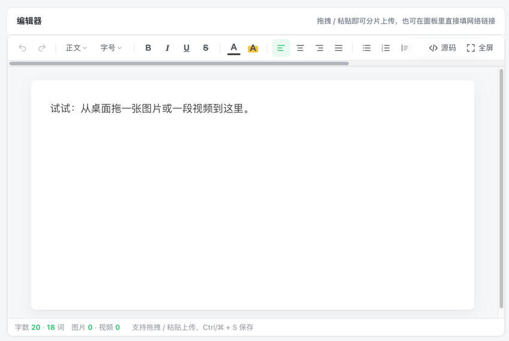

# KEditor

轻量、美观的**微信公众号风格富文本编辑器**。纯前端实现，无任何后端依赖：图片/视频走**分片上传**（并发、重试、取消、秒传、断点续传），随时切换 **HTML 源码模式**查看或改写产物。支持 `<script>` 直接引入与 Vue 3 安装集成。

- 体积：`dist/keditor.umd.js` 约 209 KB（gzip 55 KB），零运行时依赖，样式随 JS 注入
- 版式：677px 正文版心、17px/1.75 行距，与公众号观感一致；**宽屏下版心自动生长**，两侧留白恒定，不会留出一大块空白
- 安全：标签/属性白名单净化，拦截 `on*`、`javascript:`、`script/iframe`



## 功能

| 分类 | 能力 |
|------|------|
| 排版 | 段落样式面板（正文/标题一/标题二/标题三，带真实字号预览与用途说明）、字号面板（12–32px）、字体颜色与背景高亮（主题色 + 标准色 + 最近使用 + 自定义取色）、粗斜下删、四种对齐、有序/无序列表、引用、表格（网格选择）、代码块、分割线、链接、清除格式 |
| 媒体 | 图片/视频**本地上传**（点击、拖拽、粘贴截图）或**直接填网络链接**插入（自动校验可访问性）；分片进度与速度、取消、失败重试、多图多选、大图自动压缩、双击看原图、气泡工具条（对齐/宽度/圆角/替换/删除）、**选中图片后拖拽右下角把手实时缩放** |
| 上传 | `chunkSize / concurrency / retries / fingerprint` 可配；内置 mock、http、simple 适配器，也可自定义 `init/put/complete` |
| 源码 | 工具栏右侧常驻「源码」按钮（`⌘/Ctrl+Shift+K`），进入后正文按钮置灰；格式化缩进、复制、直接编辑并应用（回填自动净化） |
| 其他 | 实时字数/词数/图片视频统计、预览（手机/平板/电脑屏宽，API 与可选项）、全屏编辑、撤销重做（保留光标位置）、只读、**宽屏版心自适应**（两侧留白恒定，不随屏宽放大）、窄屏工具栏可左右滑动（常显滚动条 + 边缘渐隐 + 首次引导气泡 + 鼠标拖拽平移）且「源码/全屏」固定右端 |
| **自定义按钮** | `customButtons` 往工具栏加**下拉选择**按钮：数据可**静态配置**或**从接口读取**（`url` / `load`），选中后按配置**插入跳转链接**或直接打开；面板支持搜索、分组、加载/失败重试/空态、缓存与强制刷新；`position` 可把它放到**工具栏任意位置**（含右侧吸附尾栏）；也可运行时 `addButton` / `moveButton` / `removeButton` / `setButtonOptions` |

## 安装

```bash
npm install kyle-editor
# 使用 Vue 组件的项目
npm install kyle-editor vue@^3
```

或直接用 CDN（无需安装）：

```html
<script src="https://unpkg.com/kyle-editor/dist/keditor.umd.js"></script>
```

> 零运行时依赖；样式随 JS 注入，**不需要额外引入 CSS**。Vue 是可选 peerDependency，只用核心 API 的项目不会被强制安装。

## 快速开始

### 方式一：`<script>` 引入（零构建）

```html
<div id="editor"></div>
<script src="https://unpkg.com/kyle-editor/dist/keditor.umd.js"></script>
<!-- 本地开发时也可用相对路径：<script src="dist/keditor.umd.js"></script> -->
<script>
  const editor = KEditor.create('#editor', {
    placeholder: '开始撰写内容，支持拖拽 / 粘贴图片与视频…',
    height: 460,
  })
  editor.on('change', ({ html }) => console.log(html))
</script>
```

### 方式二：ESM / 打包器

```js
import KEditor from 'kyle-editor'

const editor = KEditor.create('#editor', { height: 460 })
```

### 方式三：Vue 3 安装集成

```js
// main.js
import { createApp } from 'vue'
import KEditorVue from 'kyle-editor/vue'

createApp(App).use(KEditorVue).mount('#app')
```

```vue
<template>
  <k-editor v-model="form.content" :options="options" :disabled="saving" @upload="onUpload" />
</template>

<script setup>
import { ref } from 'vue'

const form = ref({ content: '' })
const options = {
  height: 420,
  // 无后端时保持默认 'mock'；上线时换成下面这行即可
  uploader: { type: 'http', initUrl: '/api/upload/init', chunkUrl: '/api/upload/chunk', completeUrl: '/api/upload/complete' },
  upload: { chunkSize: 5 * 1024 * 1024, concurrency: 4 },
}
const onUpload = (payload) => console.log(payload.stage, payload.percent)
</script>
```

> `kyle-editor/vue` 的默认导出是**组件本身（自带 `install`）**，所以上面两种写法等价：
> `app.use(KEditorVue)` 后模板里用全局标签 `<k-editor>`；也可以 `import KEditorVue from 'kyle-editor/vue'` 直接当组件用 `<KEditorVue v-model="html" />`。
> 只想显式拿插件时用 `import { KEditorPlugin } from 'kyle-editor/vue'`。
>
> ESM / Webpack / Vite / React 用法见 [docs/integration.md](docs/integration.md)。

## 自定义工具栏按钮（下拉选择）

不想改源码就能往工具栏加业务按钮。典型场景：插入公司模板、关联栏目、跳转后台页面。

```js
const editor = KEditor.create('#editor', {
  customButtons: [
    // ① 数据从接口读取
    {
      name: 'column',
      text: '栏目',
      title: '插入栏目链接',
      searchable: true,               // 面板内搜索
      url: '/api/columns',            // 内部 fetch；自动识别 items/list/data/rows/records 结构
      link: true,                     // 直接用每项自带的地址（url / href / link 字段）
      insert: 'link',
    },
    // ② 数据静态配置
    {
      name: 'tpl',
      text: '模板',
      title: '插入模板',
      options: [
        { value: 'opening', label: '开场白', desc: '问候 + 本期导读', group: '通用' },
        { value: 'ending', label: '结束语', desc: '引导关注与转发', group: '通用' },
      ],
      // 链接模板：{value} / {label} 以及选项任意字段都可作占位符
      link: { url: 'https://mp.weixin.qq.com/s/tpl-{value}', text: '【{label}】', target: '_blank' },
    },
  ],
})

editor.on('customselect', ({ name, item, link, action }) => {
  console.log(name, item.label, '→', link?.url, '（插入方式：' + action + '）')
})
```

> 没传 `toolbar` 时，自定义按钮会**自动追加**到默认工具栏末尾；传了 `toolbar` 数组则按名字定位：`toolbar: ['bold', '|', 'tpl', 'column']`。
> 想换位置？写 `position`（见下）即可，不需要重抄整份工具栏。

### 按钮位置（可放在工具栏任意位置）

```js
customButtons: [
  { name: 'tpl',    text: '模板',   position: 'start' },              // 工具栏最前
  { name: 'column', text: '栏目',   position: { after: 'link' } },     // 紧跟「链接」之后
  { name: 'emoji',  text: '表情',   position: { before: 'image' } },   // 插在「图片」之前
  { name: 'ad',     text: '头图',   position: 2 },                     // 第 3 个按钮之前（0 起）
  { name: 'stats',  text: '数据',   position: 'tail' },                // 右侧吸附尾栏（与源码/全屏同区）
  { name: 'draft',  text: '草稿' },                                    // 缺省：主区末尾（尾栏之前）
]
```

| `position` 写法 | 含义 |
| --- | --- |
| `'start'` | 工具栏第一位 |
| `'end'` / 不写 | 主区末尾、右侧吸附尾栏之前 |
| `'tail'` | 右侧吸附尾栏末尾（无尾栏时回退主区末尾） |
| `number` | 第 n 个按钮之前（按视觉顺序，分隔符不计数） |
| `'link'` 等按钮名 | 插到该按钮之前 |
| `{ before: name }` / `{ after: name }` | 显式锚点；`name` 可以是内置按钮，也可以是另一个自定义按钮 |

- 错到不存在的锚点 → 自动回退主区末尾，不报错、不丢按钮。
- `toolbar` 数组里**已经写过**的自定义按钮名字以数组位置为准（`position` 被忽略），所以两种方式可以混用。
- 运行时移位（内置按钮也能移）：

```js
editor.moveButton('column', 'tail')            // 移到右侧尾栏
editor.moveButton('tpl', { after: 'image' })   // 插到图片按钮之后
editor.moveButton('hr', 0)                     // 移到第一位
```

### 数据源（优先级 `load` > `url` > `options`）

```js
// 方式 A：静态数组（也支持纯字符串、或接口原始对象，字段自动归一）
{ options: [{ value: 'a', label: '选项 A', desc: '说明', url: 'https://x.com/a' }] }
{ options: ['选项 A', '选项 B'] }

// 方式 B：自定义函数（可异步，能用编辑器实例与闭包里的 axios / 鉴权头）
{ load: async () => (await fetch('/api/tags').then((r) => r.json())).map((t) => ({ value: t.id, label: t.name })) }

// 方式 C：直接给接口地址
{
  url: '/api/columns',
  fetchOptions: { method: 'POST', headers: { Authorization: 'Bearer x' }, body: '{}', timeout: 8000 },
  pick: (json) => json.result.records,   // 结构特殊时手动提取数组
}
```

- **缓存**：默认只请求一次，面板右上角的刷新按钮可强制重新拉取；`cache: false` 则每次打开都请求
- **加载态**：面板自动显示 spinner + 骨架屏；**失败**时显示错误文案与「重试」按钮；**空数据**可用 `emptyText` 自定义提示
- **在编辑器外部拿数据**（Vue / React 里自己请求）：`editor.setButtonOptions('column', list)`

### 跳转链接配置

```js
{ link: true }                                  // 用每项自带地址
{ link: 'https://x.com/{value}' }                // 地址模板
{ link: { url: '...', text: '【{label}】', target: '_blank' } }
{ link: { mode: 'open', url: 'https://x.com/{value}' } }   // 不写正文，直接新窗口打开
{ link: (item) => ({ url: item.raw.href, text: item.label }) }  // 完全动态
```

- `mode: 'insert'`（默认）在光标处插入 `<a>`，`target: '_blank'` 时自动带 `rel="noopener noreferrer"`
- `mode: 'open'` 直接 `window.open(url, '_blank', 'noopener,noreferrer')`，不改动正文
- **安全**：地址经白名单校验，`javascript:` / `vbscript:` / `data:` 等一律不会变成链接

### 接管选中行为

```js
{
  name: 'tpl',
  options: [/* ... */],
  link: 'https://x.com/{value}',
  insert: 'link',            // 'auto'(默认) | 'link' | 'html' | 'text' | false
  onSelect: (item, ctx) => {
    analytics.track('insert_tpl', item.value)   // 埋点，不阻断默认插入
  },
}

// 完全自己处理：返回 false 则不改正文
{ onSelect: (item, ctx) => { ctx.insertHtml(item.raw.html); return false } }
```

### 运行时增删

```js
editor.addButton({ name: 'season', text: '节气', options: [...], link: 'https://x.com/{value}' })
editor.addButton(spec, { at: 0 })                    // 第 1 个按钮之前
editor.addButton(spec, { at: 'tail' })               // 右侧吸附尾栏
editor.addButton(spec, { before: 'image' })          // 或 { after: 'link' } / { position: 'start' }
editor.moveButton('season', { after: 'link' })       // 移位（内置按钮同样可用）
editor.removeButton('season')                        // 移除并中断未完成的接口请求（附带清掉随行分隔符）
editor.setButtonOptions('season', list)               // 外部灌入数据
editor.getButtonValue('column')                       // 读当前选中项
editor.setButtonValue('column', 'tech')               // 设置选中项（按钮文案同步）
```

### 普通按钮（非下拉）

```js
{ name: 'date', type: 'button', text: '插入日期', icon: 'plus', onClick: ({ editor }) => editor.commands.insertHTML('<p>2026-10-13</p>') }
```

## 版心宽度与宽屏适配

宽屏下如果版心固定 677px，编辑器两侧会出现大片空白。默认采用 **fluid 版心**：版心不小于 `paperWidth`，宽屏时随容器生长，两侧留白恒定为 `paperGap`（不再随屏宽放大）。

```js
KEditor.create('#editor', {
  paperWidth: 677,     // 版心基准宽（公众号）；fluid 模式下它是最小宽度
  paperMode: 'fluid',  // 'fluid'（默认）| 'fixed'（恒定 paperWidth + 64）
  paperGap: 24,        // fluid 模式下单侧留白
  paperMaxWidth: 0,    // fluid 模式下的版心上限，0 = 不限
})

// 运行时调整（侧栏折叠、布局变化时）
editor.setPaper({ mode: 'fixed' })
editor.setPaper({ gap: 40, maxWidth: 1000 })
editor.paperOptions()  // { width, mode, gap, maxWidth }
```

| 需求 | 配置 |
| --- | --- |
| 永远像公众号那样居中一栏 | `paperMode: 'fixed'` |
| 宽屏也想多写点字 | 默认 fluid（不限上限） |
| 宽屏但可读性优先 | fluid + `paperMaxWidth: 1000` |

> **预览按钮变更**：`preview` 已从默认工具栏移除（常驻尾栏只剩「源码 / 全屏」），预览能力不变：`editor.openPreview()` / `closePreview()` / `togglePreview()`。需要按钮时把它写回工具栏：
>
> ```js
> toolbar: [...KEditor.DEFAULT_TOOLBAR.slice(0, -1), 'preview', 'fullscreen']
> // 或直接指定尾栏：toolbar: ['bold', '|', ':tail', 'source', 'preview', 'fullscreen']
> ```

## 本地运行

```bash
npm install
npm run build          # 产出 dist/（es + cjs + umd，含 Vue 版本）
npm run dev            # 静态服务 http://127.0.0.1:5178
```

## 验证

```bash
npm run build
npm run dev &                                    # 启动静态服务
```

## 已知限制

- 依赖浏览器 `contenteditable` + `document.execCommand`（主流浏览器均支持，Chrome/Safari/Edge/Firefox 已验证）；不兼容 IE。
- 表格支持插入与行列增删，未内置单元格合并；需要时可自行扩展 `commands.js`。
- 默认适配器产生的 `blob:` 地址仅当前会话有效，正式环境请配置真实 `uploader`（见文档）。
- 强指纹（`fingerprint: 'strong'`）依赖 `crypto.subtle`，需 HTTPS 或 localhost 环境。

## License

MIT
